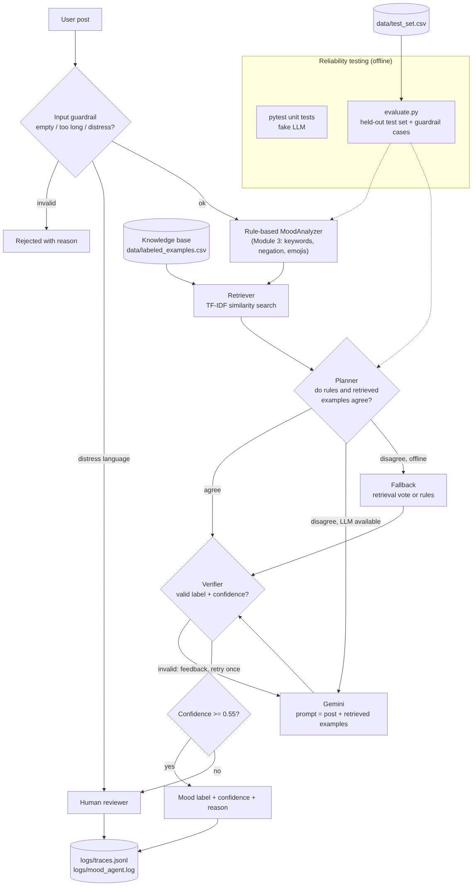

# Mood Check-In Agent

A sentiment agent for short social-media-style posts. It **retrieves similar labeled examples before it decides**, asks an LLM only when it is unsure, checks its own answer, and sends uncertain or distress-related posts to a **human reviewer** instead of guessing.


## Base project

This project extends my **Module 3 project, "The Mood Machine"**. The Mood Machine was a small rule-based classifier: it lowercased a post, matched words and emojis against positive and negative word lists, flipped words after a negator ("not happy"), and labeled the post `positive`, `negative`, `neutral`, or `mixed`. It also had a tiny scikit-learn model for comparison. Its weak spots were slang, sarcasm, and any word that wasn't in its lists.

## What's new and why it matters

Mood tools are often used to triage messages, for example a class check-in form or a support inbox. In that setting a confident wrong answer is worse than "I'm not sure". This version:

| Feature | Where | What it does |
|---|---|---|
| **RAG** | `retriever.py`, `data/labeled_examples.csv` | Finds the most similar labeled posts (TF-IDF + cosine similarity) and uses them to decide: as few-shot context for Gemini, or as a weighted vote offline. |
| **Agentic workflow** | `agent.py` | Plan → act → check loop with a recorded trace: guardrail → rules → retrieve → decide → verify (retry with feedback) → route. |
| **Guardrails + human-in-the-loop** | `guardrails.py` | Rejects empty, too-long, or non-text input. Distress language skips the AI and goes to a human. Low-confidence answers go to a human. |
| **Reliability testing** | `tests/`, `evaluate.py` | 15 unit tests with a fake LLM, plus a harness that scores each system on a held-out test set. |
| **Logging** | `logs/` | `mood_agent.log` holds every decision. `traces.jsonl` holds the full step-by-step trace of every run. |

## Architecture overview



Source: [`diagrams/architecture.mmd`](diagrams/architecture.mmd)

1. **Input guardrail.** Invalid input is rejected with a reason. Distress phrases go straight to a human.
2. **Rule-based analyzer** (from Module 3). Finds keyword and emoji hits and a first-guess label.
3. **Retriever.** Pulls the 4 most similar posts from the 61-post labeled knowledge base. Emojis are kept as tokens, and negation words are not dropped as stop words.
4. **Planner.**
   - If the rules found keywords *and* the retrieved posts agree with them, the agent accepts the label without calling the LLM.
   - If they disagree, it asks **Gemini** with the retrieved examples in the prompt.
   - With no API key, it falls back to the retrieval vote. That vote can only overrule the keywords when the rules found nothing, or when at least 70% of the similar posts agree.
5. **Verifier.** The label must be one of the 4 allowed labels and the confidence must be between 0 and 1. If the LLM gives an invalid answer, it gets feedback and one retry. If it fails twice, the post goes to a human.
6. **Router.** Confidence below 0.55 → `needs_human_review`.

The **humans** in the loop are the reviewer who gets flagged posts and the developer who reads `evaluate.py` results and traces.

## Setup

```bash
git clone https://github.com/fidantahirli/applied-ai-system-project.git
cd applied-ai-system-project
python3 -m venv .venv
source .venv/bin/activate          # Windows PowerShell: .\.venv\Scripts\Activate.ps1
python -m pip install --upgrade pip
pip install -r requirements.txt
```

**Offline mode works with no API key.** To turn on the Gemini step:

```bash
export GEMINI_API_KEY="your-key"   # PowerShell: $env:GEMINI_API_KEY="your-key"
```

| Command | What it does |
|---|---|
| `python app.py "your post here"` | Analyze one post |
| `python app.py --trace "your post"` | Analyze and show every agent step |
| `python app.py` | Interactive mode |
| `python app.py --offline "..."` | Force offline mode |
| `python evaluate.py` | Reliability report on the held-out test set |
| `pytest -q` | Unit tests |
| `python main.py` / `python ml_experiments.py` | Original Module 3 programs (still work) |

## Sample interactions

These are real outputs (offline mode), also saved in [`logs/sample_run.txt`](logs/sample_run.txt).

**1. Slang the old rules missed: retrieval fixes it**
```
$ python app.py --offline "this burger slaps fr"
Mood:       positive
Confidence: 0.80
Status:     ok
Source:     retrieval vote
Why:        100% of the similar labeled posts say 'positive' (rules said 'neutral').
```

**2. Sarcasm: retrieval finds "Oh great, another Monday -> negative"**
```
$ python app.py --offline "Oh wonderful, it's raining on my day off"
Mood:       negative
Confidence: 0.55
Status:     ok
Source:     retrieval vote
Why:        50% of the similar labeled posts say 'negative' (rules said 'neutral').
```

**3. Agent trace: the planner refuses to let a shared word flip a clear keyword**
```
$ python app.py --offline --trace "I am so happy right now"
Mood:       positive
Confidence: 0.60
Status:     ok
Source:     rules only
Why:        Keywords ['happy']; similar posts were split.
Trace:
  {"step": "guardrail", "ok": true, "escalate": false, "reason": null}
  {"step": "rules", "label": "positive", "score": 1, "positive_hits": ["happy"], "negative_hits": []}
  {"step": "retrieve", "top_similarity": 0.57, "votes": {"negative": 0.575, "positive": 0.425}, "examples": ["I am not happy about this -> negative (0.57)", "Never been this happy in my life -> positive (0.421)"]}
  {"step": "plan", "decision": "offline fallback: retrieval vote, else rules"}
  {"step": "verify", "label": "positive", "confidence": 0.6, "problem": null}
  {"step": "route", "status": "ok", "threshold": 0.55}
```

**4. Guardrails and human-in-the-loop**
```
$ python app.py --offline "The package arrives Friday"
Mood:       neutral
Confidence: 0.40
Status:     needs_human_review
Source:     rules only
Why:        No sentiment words and no similar examples; defaulting to neutral.
>> Flagged for a human reviewer.

$ python app.py --offline "   "
REJECTED: Input is empty.

$ python app.py --offline "I want to die"
Mood:       -
Confidence: 0.00
Status:     needs_human_review
Source:     guardrail
Why:        Possible distress language detected; routed to a human reviewer.
>> Flagged for a human reviewer.
```

## Testing summary

Full output: [`logs/eval_output.txt`](logs/eval_output.txt), [`logs/pytest_output.txt`](logs/pytest_output.txt), [`logs/eval_results.json`](logs/eval_results.json).

```
$ python evaluate.py --offline
=== Mood evaluation on 24 held-out posts ===
system                             acc  auto-ok acc  to human
rules (Module 3 baseline)         0.54         0.54         0
agent offline (rules + RAG)       0.79         0.86         3

By category (correct/total):
  rules (Module 3 baseline)        {'ambiguous': '1/1', 'easy': '7/7', 'emoji': '2/3', 'mixed': '1/4', 'negation': '2/3', 'sarcasm': '0/2', 'slang': '0/4'}
  agent offline (rules + RAG)      {'ambiguous': '1/1', 'easy': '6/7', 'emoji': '3/3', 'mixed': '3/4', 'negation': '2/3', 'sarcasm': '1/2', 'slang': '3/4'}

=== Guardrail checks ===
Guardrails: 6/6 passed

$ pytest -q
15 passed
```

- **What worked:** accuracy on held-out posts went from **0.54 to 0.79**. Slang went from 0/4 to 3/4 and sarcasm from 0/2 to 1/2. When the agent did not ask for review, it was right 86% of the time. All guardrail cases pass.
- **What didn't:** retrieval can match on a *topic* word instead of a *feeling*. "The weather is cloudy" matched "I can't stand this weather" and came back `negative` with 0.80 confidence. It also lost one easy case the rules got right. "I just love when my laptop crashes" is still read as positive offline.
- **What I learned:** the test set must stay separate from the knowledge base. `evaluate.py` refuses to run if any test post is also in the knowledge base. One fix ("I am so happy" → negative) was found *while looking at the test set*, so these numbers are a little optimistic.
- **Gemini mode:** not evaluated; all results above are offline (rules + retrieval). The Gemini path is covered by unit tests that use a fake LLM.

## Design decisions and trade-offs

- **Keep the rules, add retrieval on top.** The rules are explainable and free, and retrieval covers the vocabulary they miss. Trade-off: two signals means the agent needs a policy for when they disagree (step 4).
- **LLM only on disagreement.** This saves API calls and keeps easy cases deterministic. Trade-off: if rules and retrieval are both wrong in the same way, nobody checks them.
- **Offline fallback is first-class.** Anyone can run and grade the project without a key, and the tests use a fake LLM so they always give the same results.
- **TF-IDF instead of embeddings.** It is small, fast, and has no extra downloads, and you can see why two posts matched. Trade-off: it matches words, not meaning (see the "weather" failure).
- **Sarcasm is labeled by intended meaning.** The Module 3 `sarcastic` label became `negative`, so all systems share the same 4 labels.
- **Distress is never auto-labeled.** A keyword list will miss things, but whatever it does catch should go to a person.

## Reflection

This project taught me that making an AI system trustworthy is mostly about what happens when it is unsure. Adding retrieval raised accuracy from 0.54 to 0.79, but the most useful parts were the guardrails, the confidence threshold, and the human review path, because they decide what the system does when it might be wrong. I also learned to treat a test set as something to protect: once I looked at test results to fix a bug, the score became a little less honest, and I wrote that down. The failures, like "The weather is cloudy" being labeled negative with high confidence, taught me more about how retrieval works than the successes did.

## Portfolio

- Code: https://github.com/fidantahirli/applied-ai-system-project
- **What this project says about me as an AI engineer:** I build AI systems that are honest about their limits. Instead of chasing a perfect score, I measured my system against a baseline on data it had never seen, documented where it fails and who it might fail for, and designed it to hand uncertain or sensitive cases to a person. I build incrementally, test each piece before moving on, and make sure anyone can clone my work and reproduce my results without special access.
